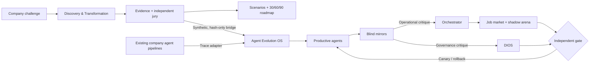

<div align="center">

# AIFIRST

### Discover what works. Evolve what delivers.

**Two connected products for evidence-led enterprise AI transformation.**

AIFIRST turns internal challenges into reviewable decisions — and gives existing agent teams an independent, reversible way to improve.

[**Try the 3 interactive demos ↗**](web/demo.html) · [**Replay Studio · Browser ↔ Node**](web/replay.html) · [**Explore the product website**](web/index.html) · [**Agent Evolution OS**](web/evolution.html) · [**Operating Atlas**](web/atlas.html) · [**Private Evidence Corpus**](web/corpus.html) · [**Run the local pilot ↓**](#run-the-real-local-pilot)

  

</div>

> **Product truth, October 2026:** The marketing website is HTML/CSS/JavaScript. The actual product runs on Node.js, SQLite and local services. **Neither product is a public production SaaS, and AIFIRST is not deployed on Vercel.** The GitHub repository is public; its data must remain synthetic. No verified customer ROI, independent security certification, production payment, or legal sign-off is claimed.

---

## Evidence Corpus · historical agent observability (October 2026)

AIFIRST can now index a private, provenance-checked collection of 2,909 agent runs, 255 agent-catalog entries and 7,592 evaluation records across 105 source definitions. It does **not** upload private prompts or the source dataset. The metadata index is tenant scoped, keyed by local HMAC pseudonyms, and has a deny-by-default `arena` partition. Human-approved `study` access and actual blind candidate benchmarks are separate concerns.

```bash
# After setting AIFIRST_ADMIN_TOKEN and AIFIRST_ALLOW_CONFIDENTIAL_LOCAL_IMPORT=1
npm run test:corpus
npm run corpus:import -- /path/to/authorized/local/evidence-folder
npm run corpus:summary
npm run pilot:serve  # open http://127.0.0.1:4181/corpus
```

**Corpus delivery caveat:** the latest source package declares 277,117 events, but its `03_TRACE_EVENTS.jsonl` was not in the attachments supplied for the import. That complete event count has not been reproduced by the new importer. Moreover, 58 evaluations do not link to a known run, 162 repeat an evaluation reference and one agent identifier occurs in two catalog entries; all are preserved for provenance review. **No historic LLM run has been exactly replayed.** See [import guide and controls](docs/EVIDENCE_CORPUS.md) and [quality findings](docs/EVIDENCE_CORPUS_QA.md). The public static preview has no corpus data.

## One company. Two operating systems.

| **01 / Discovery & Transformation** | **02 / Agent Evolution OS** |
|:---|:---|
| *Find the AI work that matters.* | *Improve the agents doing that work.* |
| Challenge intake, secure submissions, evidence-based project evaluation, independent jury, capability aggregates, organizational graph, three scenarios and a 30/60/90-day roadmap. | Governed swarm, blind mirror reviewers, a four-day job market, hidden benchmark arenas, versioned agent promotions, reversible rollouts and a constitution (*DIOS*) amendable by a unanimous signed active roster. |
| **Buyer:** CEO, CIO, transformation and innovation teams. | **Buyer:** platform engineering, AI operations and agent-system teams. |
| **Output:** 11 canonical executive deliverables (EX01–EX11), presently drafts. | **Output:** auditable version-selection decisions and portable, metadata-only traces. |

### What makes them one ecosystem?



**The boundaries matter:** critical reviews are independent; the orchestrator cannot promote itself or appoint its own judge; external trace claims are unverified until independently reproduced; humans retain authority at consequential gates. Agents are software versions, not employees. There is no employee ranking or autonomous employment decision.

## Decision Theater · 3 public interactive demos

The **[Decision Theater](web/demo.html)** is a self-contained offline HTML experience. It runs entirely in the browser, with no logins, Docker, OpenRouter API calls, telemetry, cookies, CDN, or backend.

| Demo | What you can change | What the demonstration proves |
|---|---|---|
| [Hackathon → decision](web/demo.html#discovery) | Strategy, pilot budget, risk threshold, evidence selection | Deterministic prioritization of 10 **fictional** projects; inspect source refs, blocked cases and a G5-pending recommendation |
| [Agent Arena](web/demo.html#arena) | Agent candidate, job, budget, mock independent review | Same six synthetic fixtures, quality/safety/cost gates, simulated 10% canary and reversible rollback |
| [Replace DIOS](web/demo.html#dios) | Constitutional proposal, five individual ballots, mock gate | A NO vote vetoes replacement; 5/5 YES plus a mock independent gate changes a versioned belief |

Download a JSON receipt from Discovery or Arena with inputs, scores, and a **non-cryptographic demo checksum**. Public fixtures are visible in page source, **not a real hidden benchmark**. No agent votes are cryptographically signed in this public theater; legal and production gates remain closed.

```bash
npm run test:theater     # public contracts, integrity and static routing tests
npm run test:theater:visual # actual Chromium interactions at 1440/390/320 px
npm run preview:build    # exports dist-preview/demo.html with the rest of the static showcase
# Or open web/demo.html directly in a browser; no build required.
```

The interactive showcase is deliberately separate from the private tenant-scoped API and Evolution OS runtime. [Design and assurance notes](docs/DECISION_THEATER.md). **Nothing here is a customer result, a verified security test or a production promotion.**

## Replay Studio · Browser ↔ Node, identical synthetic decisions

[**Open Replay Studio →**](web/replay.html) — change the evidence strategy, cost budget, risk ceiling, agent challenger and 5-agent DIOS votes. The *exact same public deterministic kernel* runs in a browser and in Node. Each stage explains its decisions with source IDs, vetoes and trace references. **This is NOT a hidden benchmark or an LLM evaluation.**

```bash
npm run test:replay               # tests for rule parity, tenant isolation, signatures, CSP and portable export
npm run replay:proof              # deterministic portable input/output + SHA-256
npm run replay:bridge > receipt.json  # fresh local Ed25519 signed replay, no Docker
npm run preview:build            # static, inlines identical replay kernel; no API or external JS
```

The signed replay can be imported into the browser verifier and independently recomputed; compare the signer's public-key SHA-256 fingerprint out of band before trusting the issuer. Local signature integrity **does not confer production authorization**. Unlike the separate private Agent Evolution proof, the reference replay never calls model providers, never changes agent versions and never executes code. See [security and architecture](docs/REPLAY_STUDIO.md).

## Signed receipts: public experience → private software (synthetic)

The public [Decision Theater](web/demo.html#private-verify) is an **offline simulator**, not a production run. When a local admin executes `npm run theater:proof`, the Node engine creates a new isolated synthetic hackathon, validates a SHA-256 file upload with an explicitly **MOCK** antivirus, exercises an independent Agent Evolution arena, and reproduces a unanimous signed DIOS vote in a separate sandboxed fixture. The local service signs only the summarized run evidence using its own Ed25519 key.

```bash
npm run pilot:init -- "Synthetic company"          # save admin token safely
# Set AIFIRST_SYNTHETIC_DEMO=1 and AIFIRST_ADMIN_TOKEN in your local shell
npm run theater:proof                         # no Docker, no external calls
npm run theater:verify -- .aifirst-local/receipts/<run-id>.json
npm run test:theater:verified
```

Or, with the local server running, open `/console` → **Diagnóstico** → **Prueba privada integral**, download the receipt, then open `/demo#private-verify` and import it. The browser checks Ed25519 **offline**. Because the receipt contains its own public key, verification proves only *integrity under that key*, **not** an externally trusted issuer. Pin the SHA-256 signer fingerprint out of band to establish a local trust anchor. The receipt explicitly disallows production release. No clients or employees are processed. [Operational detail](docs/PRIVATE_EXECUTION_PROOFS.md).

## See it right now — no Docker

Both product pages and the **interactive Decision Theater** can be explored from a **safe static preview** (the private operations remain read-only):

```bash
node bin/build-public-preview.mjs
# Open dist-preview/index.html in your browser.
# The preview contains no user data, login, API keys or working private backend.
```

The static build converts routes into offline-friendly files, preserves the marketing switcher, the Evolution UI tabs **and three working synthetic demos**, and **disables every backend-dependent private action**. The private console and integration lab become clear explanatory pages rather than dead links or fake working apps. When available, the generated Atlas is included as a read-only graphic.

To verify that the preview contains no private API or login interaction:

```bash
npm run test:public
```

**Important:** This preview is not a deployed SaaS; preview HTML can be hosted separately once a public release is explicitly approved. Do not point a public website at the local Node API.


## Private Trace Intelligence — observed agent ledger (2026-10-23)

AIFIRST can ingest `runs.json` + `events.jsonl` **locally** to turn actual agent activity into a tenant-isolated, HMAC-pseudonymized observability dataset. The original corpus used during development contained **1,185 runs and 237,050 events** across Codex, Claude Code and Copilot sources. **The original events and all company identifiers are confidential and are NOT committed to this repository.**

- **CLI:** `npm run trace:import -- /absolute/path/runs.json /absolute/path/events.jsonl` (requires `AIFIRST_ADMIN_TOKEN` and an explicit `AIFIRST_ALLOW_CONFIDENTIAL_LOCAL_IMPORT=1` acknowledgment).
- **Interface:** `http://127.0.0.1:4181/traces` (local API, admin/auditor/security only).
- **Derived features:** per-system metrics, pseudonymous event timeline samples, multiagent parent-run graph, and cases prioritized for independent human/critic review.
- **Integrity:** validates every event against the run inventory, exact counts, source digests, atomic import, tenant isolation and idempotent reimport.
- **Honest limitations:** full raw traces are never copied; not a full replay; no agent quality rankings, benchmark labels, public case studies, or autonomous promotions. Live SQLite is NOT encrypted by this feature. Use an encrypted private volume and do not expose this API to the Internet.

Guide: [`docs/TRACE_INTELLIGENCE.md`](docs/TRACE_INTELLIGENCE.md). Tests: `npm run test:traces`. Public static previews show a private-route placeholder instead of any trace data.

## Run the real local pilot

Requirements: **Node.js ≥22.16**. No Docker is needed for the SQLite synthetic flow.

```bash
npm run test:pilot
npm run test:evolution
npm run lab:offline-proof     # Clearly flagged mock antivirus; not Docker proof
npm run pilot:init -- "Empresa sintética"
npm run pilot:serve
```

Open these routes **on the same computer**:

| Route | What you see | Availability |
|---|---|---|
| `http://127.0.0.1:4181/` | Product landing | Local HTTP or static snapshot |
| `/evolution` | Agent Evolution OS workspace | UI; actions require local tenant/token |
| `/demo` | Decision Theater (three interactive synthetic labs) | Entirely static; no credentials |
| `/atlas` | Navigable 20-domain design graph | Static graphic |
| `/console` | Tenant-scoped Command Center | Private Node API required |
| `/lab` | Recorded integration evidence | Private Node API required |

The Node server only binds loopback and rejects foreign Host/Origin. **Do not open it to the public internet or enter real employee/client data.** The local token should never be committed or pasted into public sites.

### Full local infrastructure — *prepared, not verified here*

```bash
npm run lab:full
npm run lab:verify
```

Those commands require Docker Compose and secrets. They intend to orchestrate **Keycloak/OIDC, PostgreSQL, OpenBao Transit, S3-compatible storage and ClamAV**, then Discovery → Evolution → report generation. Docker was unavailable in the construction environment; **passing offline tests does not prove these five services ran together**. See [lab QA](docs/LAB_ONE_COMMAND_QA.md), [one-command runbook](docs/LAB_ONE_COMMAND.md), and [connection readiness](docs/CONNECTION_READINESS.md).

## What is already implemented?

| Capability | Present | What remains unverified |
|---|---|---|
| Product web + Evolution UI + Operating Atlas | HTML/CSS/JS, interactive synthetic storytelling | Public production hosting, real buyer/user studies |
| Enterprise pilot API | Node HTTP, SQLite, tenant/role checks | Production IAM, independent pen-test, HA |
| Submissions | SHA-256, quarantine, encrypted local artifacts, scanner adapters | Genuine AV/DLP and external privacy approvals |
| Agent Evolution OS | SQLite organization, mirrors, signed governance, hidden arenas, reversible promotions and rollbacks | External agent validation, live provider reliability, enterprise rollout |
| Model calls | OpenRouter Free metadata-only adapter + quotas | User API key, approved provider, actual live inference and evals |
| Reporting | Draft PDF/PPTX/CSV/JSON and encrypted bundle tooling | Audience approval, privacy permissions, legally accepted G6 |
| Local services | Compose definitions + adapters for identity, storage, encryption, audit and scanner | Docker integration proof, migrations, backup drills and production hardening |
| CRM & finance | Lead records, draft invoices and payment references | Real contract, VAT/ERP, regulated bank, confirmed settlement |

All eight gates **G0–G7** are modeled, but synthetic/local reviews are not legal authority. The architecture models **20 domains, 230 nodes and 171 links**, not 230 production-ready services. [Implementation tracker](catalog/implementation-status.json) · [Issue backlog](https://github.com/jandromani/AIFIRST/issues).

## The 11 executive outputs

| EX | Audience / purpose | EX | Audience / purpose |
|---|---|---|---|
| EX01 | CEO Report | EX02 | Board Presentation |
| EX03 | Solution Portfolio | EX04 | Aggregate Capability Atlas |
| EX05 | Knowledge Graph | EX06 | Organization Scenario Pack |
| EX07 | Roadmap 30/60/90 | EX08 | Technical & Risk Annex |
| EX09 | Private participant feedback — withheld unless authorized | EX10 | Activation Bundle |
| EX11 | Audit / Exit Bundle | | |

The current reports are **draft exports**, not final client-approved documents. See [canonical deliverables](catalog/original-deliverables.json), [enterprise pack](docs/ENTERPRISE_INTEGRATIONS.md), and [delivery gates](docs/DEFINITION_OF_DONE.md).

## Engineering & reproducibility

```bash
npm test                      # Historical Node suite (full checkout)
npm run verify:local          # Catalog, gates, synthetic flow and generated Atlas
npm run test:hardening        # HTTP boundary, mock provider, integrity and queue
npm run test:evolution:extended
npm run test:lab:integrated
npm run test:public           # Standalone, safe marketing preview
```

Tests from earlier iterations are documented individually in [Agent Evolution QA](docs/AGENT_EVOLUTION_QA.md), [integration audit](docs/AGENT_EVOLUTION_RELEASE_AUDIT.md), [lab QA](docs/LAB_ONE_COMMAND_QA.md) and [UI/UX audit](docs/UIUX_UNICORN_AUDIT.md). **Only trust successful output from a command actually run in your checkout**; past partial checkouts were missing historical files and full Docker validation has not been completed.

## Integrate Evolution OS with your own agents

Start with the [portable trace contract](docs/AGENT_EVOLUTION_SDK.md). Adapters can ingest **sanitized metadata** from LangGraph, CrewAI, OpenAI Agents SDK, n8n or custom workers. A submitted trace is an *observation*, not independent proof; no external agent can approve its own promotion. The evolution engine uses separate mirror channels, hidden evaluations, gates and rollback policies.

```text
Task + criteria → productive agent → evidence/trace → blind mirror
                                                  ↘ orchestrator improvement plan
                          DIOS ← private governance audit
Aspirant → blind arena → independent reviewer → canary / rollback
```

**DIOS is a versioned set of common beliefs**, not an omnipotent agent. Changing those beliefs requires a frozen active roster and **valid signatures from every eligible member**; immutable safety rules and independent release controls remain outside that vote.

## Release policy

- **Public static preview:** possible without Docker. No client data, tokens or operational endpoints. Not yet hosted on Vercel.
- **Local synthetic product:** executable and testable with Node + SQLite; external provider calls are off by default.
- **Local Docker lab:** Compose and bootstrap implemented; full five-service proof pending.
- **Enterprise production:** **not verified**. Requires real SSO/MFA, key custody, tested containment, privacy/legal review, production observability and recovery, signed approvals and financial integrations.

Want to evaluate the idea or contribute to the prototype? Start with the [Operating Atlas](web/atlas.html), the [two-product architecture](docs/AGENT_EVOLUTION_INTEGRATION.md), and [open issues](https://github.com/jandromani/AIFIRST/issues).

<sub>Evidence first. No fictitious traction, invented customer logos or claims that a mock integration proves production readiness.</sub>

## Historical Acceptance Lab · decisions grounded in the private corpus (2026-10-23)

AIFIRST now has a **private historical casebook** covering ten anonymized governance scenarios: an ordered reviewer chain, retries, factory failure, sensitive-data boundary veto, DoR/DoD and adversarial gates, injected timeout recovery, rejecting judges and an A/B prompt heuristic.

- `npm run test:history` runs synthetic policy fixtures; these are not customer evidence.
- `npm run history:import -- /path/to/private/AIFIRST_AGENT_TRACE_EVIDENCE` verifies and privately imports the ten user-authorized samples against their SHA-256 provenance (requires local admin token and `AIFIRST_ALLOW_CONFIDENTIAL_LOCAL_IMPORT=1`).
- `npm run history:list` and `http://127.0.0.1:4181/history` show decision reasons and allowlisted aggregates to authorized local auditors.
- A case passing historical assertions **never authorizes a promotion**: all ten remain blocked pending hidden independent benchmarks, versioned runs and explicit human gates.

Read [Historical Acceptance](docs/HISTORICAL_ACCEPTANCE.md) and [QA limitations](docs/HISTORICAL_ACCEPTANCE_QA.md). The original samples, content hashes, model payloads and private SQLite are not published, and the static preview contains only a placeholder instead of this control plane.
